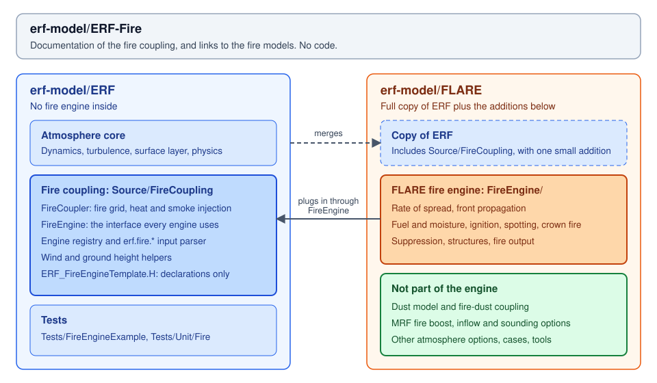

# ERF-Fire

This repository holds the documentation for mapping wildfire models to ERF, as
well as links to the models themselves.

A wildland fire and the atmosphere drive each other: the wind spreads the fire,
and the fire's heat drives the wind. The code is split along that line.

| Part | What it does | Where it lives |
|---|---|---|
| **Fire coupling** | The atmosphere side: where the fire grid sits, what the fire is handed each step, and how its heat, water vapour and smoke enter the atmosphere | [erf-model/ERF](https://github.com/erf-model/ERF), `Source/FireCoupling` |
| **Fire engine** | The fire model: spreads the front and reports the heat it releases | Its own repository, outside ERF |

ERF contains no fire engine of its own. An engine plugs into the coupling
through one interface, and ERF needs no change to add one.

## Documentation

- [The fire coupling in ERF](docs/fire-coupling-in-erf.md): what moved into ERF,
  how to build it, its inputs, and what an engine must provide.
- [FLARE](docs/flare.md): the engine, and what the FLARE repository holds that is
  not part of the engine.
- [Tutorials](docs/tutorials.md): placeholder; the tutorials are not written yet.

## Fire models

| Model | Repository | Selected with |
|---|---|---|
| FLARE (Fire-Line Advancement and Reaction Engine) | [erf-model/FLARE](https://github.com/erf-model/FLARE) | `erf.fire.engine = flare` |

Each model's team maintains the description of its own model.

## Names

Until October 2026 the native fire model was developed on the `ERF-Fire` branch
of `hgopalan/ERF`. Its coupling code then moved into ERF, and the model became
FLARE. In this repository, "ERF-Fire" means the fire coupling in ERF and this
documentation, not one fire model.
