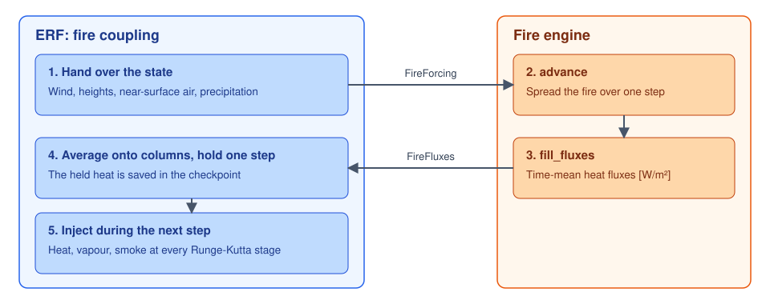

# Fire–Atmosphere Coupling in ERF

ERF provides the atmosphere side of a coupled fire simulation: it hosts the fire
grid, supplies the near-surface state to a fire engine, and returns the engine's
heat, water vapour and smoke to the atmosphere. This page summarises that
interface. The complete reference is the ERF documentation page
[Fire-Atmosphere Coupling](https://erf.readthedocs.io/en/latest/theory/FireCoupling.html)
and the Fire Coupling table in
[Inputs.rst](https://github.com/erf-model/ERF/blob/development/Docs/sphinx_doc/Inputs.rst).

## Background

The coupling layer was developed on the `ERF-Fire` branch of `hgopalan/ERF` and
proposed in erf-model/ERF#4288 by Harish Gopalan. Ann Almgren merged it into ERF in
erf-model/ERF#4798 (2026-10-27), together with Nicholas Wimer's hgopalan/ERF#519,
#520 and #521 and the single engine interface for external codes planned in
erf-model/ERF#4768. erf-model/ERF#4288 was closed in favour of that PR.

ERF contains the coupling only. Rate-of-spread models, fuel models and front
propagation schemes remain in the fire engines.

## Components in ERF

| Location | Contents |
|---|---|
| `Source/FireCoupling` | The `FireCoupler` class, the `FireEngine` interface, the engine registry, the input parser, and helpers for the wind and ground height |
| `Source/FireCoupling/ERF_FireEngineTemplate.H` | Annotated declarations of every engine method (reference only; not compiled into a run) |
| `Tests/FireEngineExample` | A complete example engine, a prescribed growing disk of heat, built by CI |
| `Tests/Unit/Fire` | Unit tests that use a stand-in engine |
| ERF core | Hooks for start-up, time advance and source terms, the fire plotfile, and a `ScalarLayout` record in every checkpoint |

## Building with fire support

Fire coupling is disabled by default. When it is enabled, the state carries one
additional passive scalar, the smoke tracer, whether or not a fire is run. Each
checkpoint records the number of scalars, so a restart with a differently
configured build is rejected.

Engines are compiled from their own directories against the same ERF source tree:

```bash
cmake -S /path/to/ERF -B cmake-build -DERF_ENABLE_FIRE=ON \
      -DERF_FIRE_ENGINE_DIRS="/path/to/fire-engine;/path/to/other-engine"
```

With GNU make, set `ERF_HOME = /path/to/ERF`, `USE_FIRE = TRUE` and
`FIRE_HOME = /path/to/fire-engine` before including `$(ERF_HOME)/Exec/Make.ERF`.

A run with `erf.fire.enable = true` stops at start-up if no engine is compiled
in. When several engines are compiled into one executable, `erf.fire.engine`
selects one at run time.

## Coupling sequence



1. At start-up, the coupler builds the fire grid by refining one AMR level by
   `erf.fire.grid_ratio` in x and y.
2. Each step, it passes the engine the face velocities, the cell-centre heights,
   the air temperature and relative humidity of the lowest cell, and the surface
   precipitation if the engine requests it.
3. The engine advances and returns the sensible and latent heat fluxes into the
   air [W/m²], averaged over its step.
4. The coupler averages these fluxes onto the atmospheric columns and holds them
   for one step.
5. It injects them at every Runge-Kutta stage of the next step, together with the
   smoke tracer when smoke is enabled.

Steps 4 and 5 apply to `lagged` and `synchronous` coupling. With `passive`
coupling no heat is injected; only the smoke tracer is, when enabled.

The held fluxes are written to the checkpoint, so a restarted run injects the
same heat in its first step as an uninterrupted run.

## Limitations

- The level that hosts the fire grid must keep the same boxes for the whole run.
- Its boxes must form a single rectangle, and each box must span the full height
  of the level, so a refined fire level must extend to the domain top.
- Every box length in x and y must be divisible by the grid ratio.
- The bottom boundary must be a surface layer, unless the engine declares that it
  reads nothing from one.
- When the fire grid lies below the finest level, average-down overwrites the
  heated cells beneath the finer level and that heat is lost; the coupler warns
  at start-up.
- A restart that regenerates the level-0 grids stops before the checkpoint is
  read.

## Coupling inputs

| Input | Effect |
|---|---|
| `erf.fire.enable` | Enables the fire |
| `erf.fire.engine` | Selects the compiled-in engine |
| `erf.fire.grid_ratio` | Fire cells per atmospheric cell in x and y |
| `erf.fire.anchor_level` | Level refined by the fire grid; -1 selects the finest |
| `erf.fire.coupling_type` | `passive`, `lagged` (default) or `synchronous` |
| `erf.fire.fire_atm_feedback` | Multiplier on the injected fluxes; 0 gives one-way coupling |
| `erf.fire.heat_profile` | `exponential` (default) or `bottom_cell` |
| `erf.fire.heat_flux_alfg` | E-folding depth of the exponential profile (default 45 m) |
| `erf.fire.heat_open_fraction` | Distributes the heat using the open fraction and roof height reported by the engine |
| `erf.fire.heat_tendency_exner` | Divides the tendency by the Exner function (default true) |
| `erf.fire.heat_tendency_density` | Multiplies the tendency by the air density |
| `erf.fire.inject_latent` | Injects the latent flux into the water vapour equation |
| `erf.fire.source_mode` | `overwrite` (default) or `add`, relative to other sources in the same slots; if unset, the run stops at start-up when another source, such as radiation or Rayleigh damping, writes to those slots |
| `erf.fire.smoke_enable` | Injects the smoke tracer; requires `erf.transport_scalar` |
| `erf.fire.smoke_emission_factor` | Smoke mass per unit fuel mass burned (default 0.02 kg/kg) |
| `erf.fire.plot_file`, `plot_int`, `plot_per` | Controls the engine's fire plotfile |
| `erf.fire.fire_debug` | Prints per-step coupling diagnostics |

Each engine reads its own inputs under its own prefix; `fire.<engine>.*` is
recommended.

## Implementing a fire engine

An engine derives from `FireEngine` (`Source/FireCoupling/ERF_FireEngine.H`) and
registers itself in a `.cpp` file compiled as source:

```cpp
ERF_REGISTER_FIRE_ENGINE(MyEngine, "my_fire")
```

| Required method | Purpose |
|---|---|
| `name` | Returns the engine's name |
| `verify_prerequisites` | Checks the mesh and inputs at start-up |
| `initialize` | Sets up the engine on the fire grid |
| `advance` | Advances the fire over one step |
| `fill_fluxes` | Returns the sensible and latent fluxes, averaged over that step |
| `smoke_heat_per_kg` | Heat released per kilogram of fuel burned |

Optional methods cover checkpoint and plotfile output, surface precipitation, the
surface-layer requirement, building open fraction and roof height, and fields
offered to other surface models. An engine that keeps the default
`read_checkpoint` stops a restarted run with an explanatory message.

An engine directory contains `ERFFireEngine.cmake` for CMake and `Make.package`
for GNU make. To start a new engine, copy `Tests/FireEngineExample` or the
template, then follow the sections "Adding a fire engine" and "The engine
contract" in the ERF documentation, which define the rules for fluxes, water and
GPU memory.
