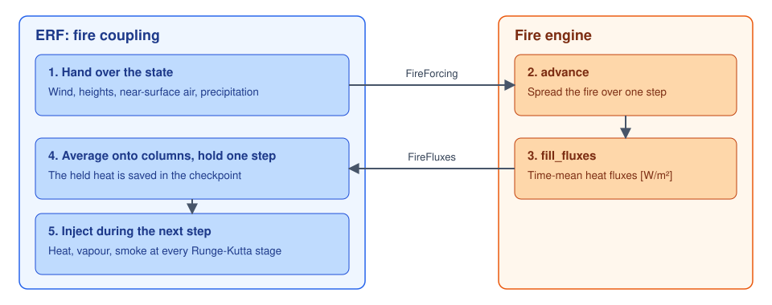

# The fire coupling in ERF

This page summarises what ERF provides for fire models. The full reference is
the ERF page
[Fire-Atmosphere Coupling](https://github.com/erf-model/ERF/blob/development/Docs/sphinx_doc/theory/FireCoupling.rst)
and the Fire Coupling table in
[Inputs.rst](https://github.com/erf-model/ERF/blob/development/Docs/sphinx_doc/Inputs.rst).

## What moved into ERF

The atmosphere side of the coupling was written on the `ERF-Fire` branch of
`hgopalan/ERF` and proposed in erf-model/ERF#4288 by Harish Gopalan. Ann Almgren
merged it in erf-model/ERF#4798 on 2026-10-27, together with Nicholas Wimer's
hgopalan/ERF#519, #520 and #521 and the single engine interface for code outside
ERF planned in issue erf-model/ERF#4768. erf-model/ERF#4288 was closed in favour of
that PR.

| In ERF | Contents |
|---|---|
| `Source/FireCoupling` | The `FireCoupler` class, the `FireEngine` interface, the engine registry, the input parser, and helpers for the wind and ground height |
| `Source/FireCoupling/ERF_FireEngineTemplate.H` | Declarations of every engine method, with comments; never run |
| `Tests/FireEngineExample` | A complete engine directory: a prescribed growing disk of heat, built by CI |
| `Tests/Unit/Fire` | Unit tests with a stand-in engine |
| Hooks in the ERF core | Start-up, advance and source terms, fire plotfile, and a `ScalarLayout` file in every checkpoint |

The fire physics did not move. No rate of spread, fuel model or front
propagation scheme is in ERF.

## Building

The coupling is off by default. With it on, the state carries one more passive
scalar, the smoke tracer, whether or not a fire runs. A checkpoint records the
number of scalars, so a build configured differently refuses to restart from it.

Engines are built from their own directories against the same ERF source tree:

```bash
cmake -S /path/to/ERF -B cmake-build -DERF_ENABLE_FIRE=ON \
      -DERF_FIRE_ENGINE_DIRS="/path/to/fire-engine;/path/to/other-engine"
```

With GNU make, set `ERF_HOME = /path/to/ERF`, `USE_FIRE = TRUE` and
`FIRE_HOME = /path/to/fire-engine` before including `$(ERF_HOME)/Exec/Make.ERF`.

`erf.fire.enable = true` stops at start-up if no engine is compiled in. With
several engines in one executable, `erf.fire.engine` picks one at run time.

## What the coupling does each step



1. It builds the fire grid at start-up. The grid refines one AMR level by
   `erf.fire.grid_ratio` in x and y.
2. It hands the engine the face velocities, cell-centre heights, lowest-cell air
   temperature and relative humidity, and surface precipitation if the engine
   asks for it.
3. The engine advances and reports the sensible and latent heat flux into the air
   [W/m²], averaged over its step.
4. The coupling averages the fluxes onto the atmospheric columns and holds them
   for one step.
5. It injects them at every Runge-Kutta stage of the next step, with the smoke
   tracer if that is on.

Steps 4 and 5 describe `lagged` and `synchronous` coupling. With `passive`
coupling no heat is injected; only the smoke tracer is, if it is on.

The held heat is saved in the checkpoint, so a restarted run injects the same
heat in its first step as an uninterrupted run.

**Limits.** The fire grid's level must keep its boxes for the whole run. Its boxes
must form one rectangle, and each box must span the level's full height, so a
refined level must reach the domain top. Every x and y box length must
be divisible by the ratio. The bottom boundary must be a surface layer unless the
engine says it reads nothing from one. With the fire grid below the finest level,
average-down replaces the heated cells under the finer level and that heat is
lost; the coupling warns at start-up. A restart that re-makes the level-0 grids
stops before reading the checkpoint.

## Inputs

| Input | Effect |
|---|---|
| `erf.fire.enable` | Run a fire |
| `erf.fire.engine` | Which compiled-in engine runs |
| `erf.fire.grid_ratio` | Fire cells per atmospheric cell in x and y |
| `erf.fire.anchor_level` | Level the fire grid refines; -1 is the finest |
| `erf.fire.coupling_type` | `passive`, `lagged` (default) or `synchronous` |
| `erf.fire.fire_atm_feedback` | Multiplier on the injected fluxes; 0 is one-way coupling |
| `erf.fire.heat_profile` | `exponential` (default) or `bottom_cell` |
| `erf.fire.heat_flux_alfg` | E-folding depth of the exponential profile (default 45 m) |
| `erf.fire.heat_open_fraction` | Place the heat by the open fraction and roof height an engine reports |
| `erf.fire.heat_tendency_exner` | Divide the tendency by the Exner function (default true) |
| `erf.fire.heat_tendency_density` | Multiply the tendency by the air density |
| `erf.fire.inject_latent` | Inject the latent flux into the vapour equation |
| `erf.fire.source_mode` | `overwrite` (default) or `add`, relative to other sources in the same slots; left unset, the run stops at start-up if another source such as radiation or Rayleigh damping writes there |
| `erf.fire.smoke_enable` | Inject the smoke tracer; needs `erf.transport_scalar` |
| `erf.fire.smoke_emission_factor` | Smoke per fuel burned (default 0.02 kg/kg) |
| `erf.fire.plot_file`, `plot_int`, `plot_per` | The engine's fire plotfile |
| `erf.fire.fire_debug` | Print per-step coupling diagnostics |

An engine reads its own inputs under its own prefix; `fire.<engine>.*` is
recommended.

## What an engine provides

An engine derives from `FireEngine` (`Source/FireCoupling/ERF_FireEngine.H`) and
registers itself in a `.cpp` compiled as source:

```cpp
ERF_REGISTER_FIRE_ENGINE(MyEngine, "my_fire")
```

| Required method | Purpose |
|---|---|
| `name` | The engine's name |
| `verify_prerequisites` | Check the mesh and inputs at start-up |
| `initialize` | Set up on the fire grid |
| `advance` | Advance the fire over one step |
| `fill_fluxes` | Return the sensible and latent flux, averaged over that step |
| `smoke_heat_per_kg` | Heat released per kilogram of fuel burned |

The optional methods cover checkpoint and plotfile output, surface precipitation,
the surface-layer requirement, building open fraction and roof height, and fields
offered to other surface models. An engine that keeps the default `read_checkpoint`
stops a restarted run with a message.

An engine directory holds `ERFFireEngine.cmake` for CMake and `Make.package` for
GNU make. To start a new model, copy `Tests/FireEngineExample` or the template,
then follow "Adding a fire engine" and "The engine contract" on the ERF page. Those
sections give the flux, water and GPU memory rules.
