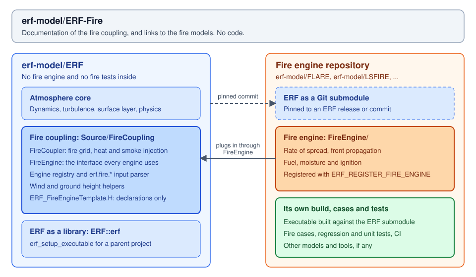

# FLARE

FLARE (Fire-Line Advancement and Reaction Engine) is the fire engine in
[erf-model/FLARE](https://github.com/erf-model/FLARE). It was the native fire
model on the `ERF-Fire` branch of `hgopalan/ERF` until October 2026.

FLARE holds ERF as a Git submodule, `Submodules/ERF`, and builds its own
executable, `flare`, against ERF's library (erf-model/FLARE#28 by Ann Almgren,
2026-11-13). Before that change the FLARE repository was a full copy of ERF
plus the engine. The
[FLARE README](https://github.com/erf-model/FLARE/blob/development/README.rst)
describes its capabilities and how to build it. This page covers how FLARE maps to
ERF, and what its repository holds besides the engine.



## How FLARE maps to ERF

| Coupling item | In FLARE |
|---|---|
| ERF | `Submodules/ERF`, pinned to an ERF release or a later ERF commit |
| Engine directory | `FireEngine/` |
| Registration | `ERF_REGISTER_FIRE_ENGINE(NativeFireEngine, "flare")` in `ERF_NativeFireEngine.cpp` |
| Selection | `erf.fire.engine = flare`; it is the only engine compiled into `flare`, so a deck need not name it |
| Build | FLARE's `CMakeLists.txt` adds `Submodules/ERF` and builds `flare` with `erf_setup_executable`; `ERF_ENABLE_FIRE` is ON by default in FLARE and OFF in ERF |
| Tests | FLARE's own regression and unit tests (`-DFLARE_ENABLE_TESTS=ON`), run in FLARE's CI; ERF's tests stay in ERF |

```bash
git clone --recursive https://github.com/erf-model/FLARE.git FLARE
cd FLARE
cmake -S . -B cmake-build -DERF_ENABLE_MPI=ON
cmake --build cmake-build -j
```

**Fire engine contents.** The rate-of-spread models, the Huygens and level-set
front propagation, fuel and fuel moisture, ignition, acceleration, spotting, crown
fire, suppression, structure ignition, and the fire plotfile, statistics and
checkpoint.

## In the FLARE repository but not in the engine

FLARE holds no ERF code outside `Submodules/ERF`. Its other parts sit in its
own folders and reach ERF through ERF's plug-in interfaces. Its problem file,
`Exec/ERF_Prob.cpp`, started as a copy of ERF's and has FLARE's changes.

| Item | Where in FLARE | Inputs | What it does | Tied to fire? |
|---|---|---|---|---|
| Dust model | `Dust/` | `erf.dust.model = flare`, `erf.dust.*`, `ERF_ENABLE_DUST` | Emission, settling, deposition and health diagnostics for bare mineral surfaces, through ERF's dust coupling | No |
| Fire-dust coupling | `Dust/ERF_DustFireLofting.*` | `erf.fire_dust_coupling`, `erf.fire_dust_crust_reduction`, `erf.fire_dust_wind_*`, `erf.fire_dust_lofting_*` | Feeds the fire's burned area, outflow wind and heat flux into dust emission | Yes |
| Structures | `Structures/` | `ERF_ENABLE_STRUCTURES` | Towers and conductors, through ERF's structure model interface | Partly |
| Problem file | `Exec/ERF_Prob.cpp` | `erf.abl_geo_wind` | ERF uses this key as forcing only. FLARE's problem file also starts the velocity from it | No |
| Cases and tools | `Exec/CanonicalTests`, `Exec/RegTests`, `Exec/Tools` | | Fire and dust cases; LANDFIRE fuel map, HRRR winds and map movie scripts | Mostly |
| Tests | `Tests/` | | Fire and dust regression and unit tests, the example fire engine and example dust model | Mostly |

The dust model is the largest of these. It uses the same surface-grid design as
the fire model, but it runs with `ERF_ENABLE_DUST=ON` and a fire is not required.

## ERF changes before the switch

Before the switch to a submodule, Ann Almgren moved FLARE's general additions to
ERF itself, moved the fire and dust tests from ERF to FLARE, and made ERF
usable as a library. All of these are in the ERF commit FLARE pins.

| Item | Inputs | ERF pull request |
|---|---|---|
| Dust coupling and dust model interface | `erf.dust.model` | erf-model/ERF#5091 |
| Fire and dust tests out of ERF | | erf-model/ERF#5095 |
| ERF as a library for a parent project | `erf_setup_executable` | erf-model/ERF#5096 |
| YSU-new boundary-layer height | `erf.most.pblh_calc = YSUNew` | erf-model/ERF#5098 |
| Imposed surface heat flux with `bulk_coeff` | `erf.most.surf_temp_flux` | erf-model/ERF#5099 |
| Warm bubble | `prob.bubble_*` | erf-model/ERF#5100 |
| Building-roof stability | `erf.ibseb.stability_scheme = louis` | erf-model/ERF#5101 |
| Terrain-following inflow, sounding above ground | `<face>.inflow_profile`, `erf.input_sounding_{wind,theta}_above_ground` | erf-model/ERF#5102 |
| MRF fire boost | `erf.pbl_mrf_fire_thermal_excess`, `erf.mrf_fire_q_threshold` | erf-model/ERF#5105 |

FLARE dropped its join of refined boxes stacked in z, which ERF's
`amr.no_box_split_dir = 2` default makes unnecessary. The matching
level-creation check, erf-model/ERF#5104, was closed unmerged.

## FLARE model documentation

The pages below describe the FLARE fire model and its inputs. They are copied
from the [FLARE documentation](https://github.com/erf-model/FLARE/tree/development/Docs/sphinx_doc)
by `tools/sync_flare_docs.py`; edit them in FLARE and rerun the script.

```{toctree}
:maxdepth: 2

flare/Fire
flare/inputs
```
