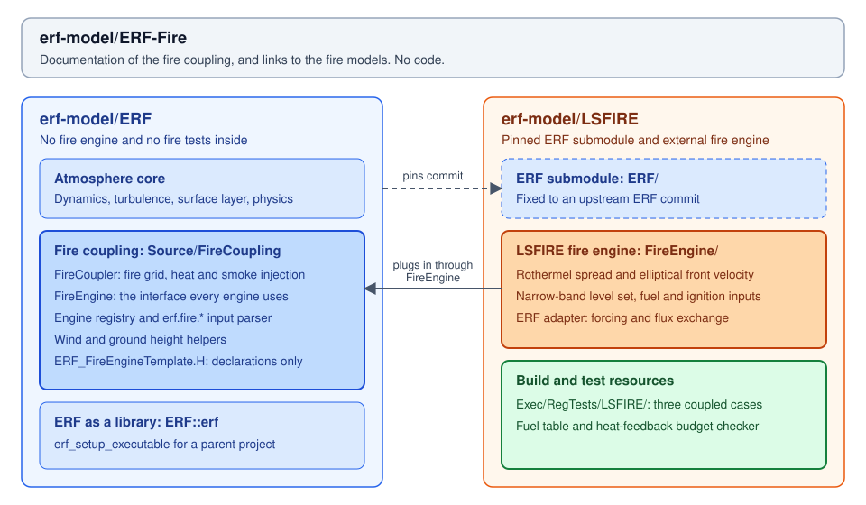

# LSFIRE

LSFIRE is a level-set wildland fire spread model built on AMReX, in
[erf-model/LSFIRE](https://github.com/erf-model/LSFIRE). It uses Rothermel surface
spread, an elliptical fire-front model, and an ELMFIRE-style narrow band to
advance the fire perimeter.

The repository includes the fire engine and a pinned upstream ERF submodule.
See the [LSFIRE user documentation](https://github.com/erf-model/LSFIRE/blob/main/docs/README.md)
for build instructions, a quick start, and input options.

## How LSFIRE maps to ERF

| Coupling item | In LSFIRE |
|---|---|
| Engine directory | `FireEngine/` |
| Registration | `ERF_REGISTER_FIRE_ENGINE(FireELMFIRE, "lsfire")` in `ERF_FireELMFIRE.cpp` |
| Selection | `erf.fire.engine = lsfire`, with `erf.fire.enable = true` |
| Build | `ERF_ENABLE_FIRE=ON` and `ERF_FIRE_ENGINE_DIRS=/path/to/LSFIRE/FireEngine` |
| Adapter | `FireEngine/ERF_FireELMFIRE.*`, with fuel and ignition readers |
| Model core | `FireEngine/LSFIRE/include` and `FireEngine/LSFIRE/src` |
| Atmospheric coupling | ERF's `Source/FireCoupling`, in the `ERF/` submodule |

The engine is compiled into `erf_exec` with ERF's own AMReX. There is no separate
`libelmfire_core.a` to build or link. `ERFFireEngine.cmake` and `Make.package`
provide the CMake and GNU make hooks. The `ELMFIRE` names in the adapter and core
are retained implementation names; the registered engine name is `lsfire`.

## Fire engine contents

| Part | Where | What it does |
|---|---|---|
| ERF adapter | `FireEngine/ERF_FireELMFIRE.*` | Sets up the LSFIRE hierarchy on ERF's fire grid, passes wind and terrain to the core, and returns time-averaged fluxes |
| Fuel and ignition readers | `FireEngine/ERF_FireReadFuel.cpp`, `ERF_FireReadIgnition.cpp` | Read LANDFIRE fuel IDs and area-ignition masks from NetCDF |
| Model API | `FireEngine/LSFIRE/include/ELMFIRE_API.H` | Exposes the core configuration, advance, and field access |
| Fire hierarchy | `FireEngine/LSFIRE/src/Core` | Manages fire levels, time stepping, ignition, and output |
| Spread physics | `FireEngine/LSFIRE/src/Physics` | Rothermel spread, fuel models, elliptical front velocity, and optional spotting |
| Front propagation | `FireEngine/LSFIRE/src/Numerics`, `FireEngine/LSFIRE/src/DataStructures` | Limited gradients, second-order Runge–Kutta integration, and narrow-band data |

These are fire-model components. The atmospheric source placement, Exner
conversion, and smoke injection belong to ERF's shared coupling, described in
[The fire coupling in ERF](fire-coupling-in-erf.md).

## Wind and heat exchange

The engine has two wind modes:

| Input | Wind used by the fire |
|---|---|
| `fire.mode = constant_wind` | Prescribed `fire.constant_wind_u/v`, interpreted as the 20-ft wind |
| `fire.mode = atmospheric` | ERF's lowest-cell wind (`k = 0`), with its height above the local ground; the core converts it to the 20-ft wind using a log law |

The atmospheric wind is copied to the fire cells covered by each ERF cell and
held fixed during a fire update. It adds no sub-cell wind structure.
`fire.atmos_wind_height` can override the actual height for idealized tests.

The fire takes internal CFL steps to reach the end of the update. The adapter
accumulates sensible heat and water-vapour mass flux over those steps and returns
their time averages. Sensible heat is returned in W/m²; the water-vapour mass
flux is multiplied by ERF's latent heat of vaporization to return latent heat in
W/m². The current core assigns 75% of the burning-cell reaction intensity to
sensible heat and 25% to latent heat.

With `erf.fire.coupling_type = passive`, fire heat and moisture do not feed back
to the atmosphere. With `lagged`, ERF injects the returned fluxes during the next
atmospheric step. Heat placement and smoke are controlled by `erf.fire.*` inputs;
the engine's model inputs remain under `fire.*` and `fire_amr.*`.

## Repository layout

| Item | Where | Purpose |
|---|---|---|
| ERF | `ERF/` | Pinned upstream submodule containing the atmosphere and shared fire coupling |
| Build scripts | `Build/` | CMake build script and a Perlmutter environment setup |
| Coupled cases and tools | `Exec/RegTests/LSFIRE/` | Input files, fuel table, plotfile reader, and heat-feedback budget checker |

The build script enables NetCDF. The Perlmutter environment script is specific
to that machine; other systems need their own compiler and dependency setup.

## Coupled regression tests

The [coupled-test README](https://github.com/erf-model/LSFIRE/blob/main/Exec/RegTests/LSFIRE/README.md)
records reference comparisons with one MPI rank:

| Case | What it checks |
|---|---|
| `inputs_lsfire_constant_wind` | Agreement with standalone LSFIRE on the same 10 m fire grid at 1 h and 6 h |
| `inputs_lsfire_atmos_wind` | Transfer of ERF's lowest-cell wind and its height to the fire grid |
| `inputs_lsfire_heat_feedback` | Lagged sensible-heat and water-vapour budgets, using ERF's default exponential heat profile and Exner conversion |

The coupled-test README gives the reference values and instructions for running
the heat and moisture budget checker.

## Model description paper

Liu, Y., Huang, H., Saltiel, T. M., Feng, S., Coleman, A., and Almgren, A. (2026).
*ERF-LSFIRE v1.0: Coupling a Level-Set Fire Model with the Energy Research and
Forecasting Model for Fire-Atmosphere Simulations*. EGUsphere preprint.
[https://doi.org/10.5194/egusphere-2026-5430](https://doi.org/10.5194/egusphere-2026-5430).
